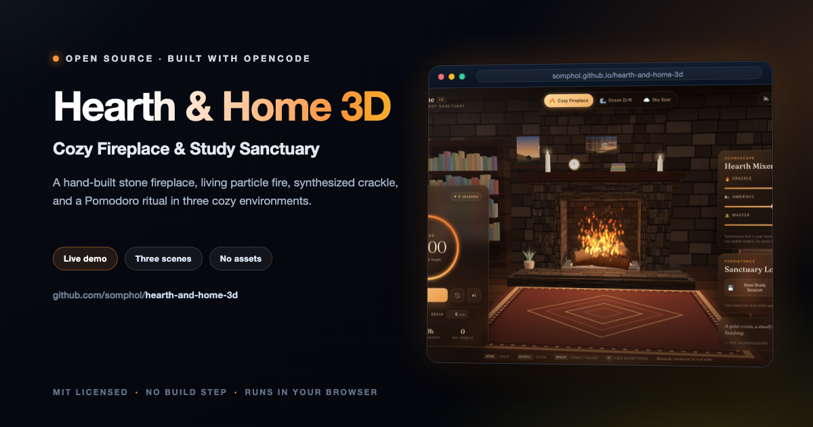

<div align="center">



# Hearth & Home 3D

**Cozy Fireplace & Study Sanctuary**

A hand-built stone fireplace, a living particle fire, a five-layer synthesized soundscape that starts on its own, and a Pomodoro ritual in three cozy environments.

[](https://somphol.github.io/hearth-and-home-3d/)
[](LICENSE)

**[Try it live →](https://somphol.github.io/hearth-and-home-3d/)**

</div>

---

## The experience

| 🔥 Cozy Fireplace | 🌊 Ocean Drift | ☁️ Sky Soar |
| --- | --- | --- |
|  |  |  |

- **Cozy Fireplace** — a procedural study room with a stone hearth, stacked logs, a bookshelf, armchair, rug, candlelight, and a flickering fire that casts dynamic shadows.
- **Ocean Drift** — an animated sunset sea with a lantern-lit sailboat, a distant lighthouse, drifting clouds, and a custom water shader.
- **Sky Soar** — floating islands, a striped hot-air balloon, birds, a tiny cabin with a warm window, fireflies, and a sea of clouds.

Switch environments at any time without reloading. Each one brings its own soundscape and camera framing.

## Highlights

### 3D & atmosphere
- Three.js r128 with `OrbitControls`, ACES tone mapping, sRGB output, and soft shadow maps.
- Procedural canvas textures for stone, wood, rugs, night windows, book spines, framed art, clouds, and balloon fabric — no external image assets.
- A 400+ point GPU particle system for flames, embers, smoke, and dust, with a custom shader and per-particle colour, size, and alpha.
- A flickering point light inside the hearth, plus a warm room fill, window moonlight, candle glows, and an animated ember bed.
- Fireplace, ocean, and sky each have their own update loop, camera limits, fog/exposure, and ambient motion.

### Sound, synthesized live
No audio files are downloaded. The Web Audio API builds everything in the browser:
- **On by default** — the fireplace mix rises automatically. If the browser blocks autoplay, it shows **Tap to hear** and wakes on your first touch.
- **Five mixable layers** — Fire crackle, Room tone, Ocean waves, Wind, and Rain. Toggle any combination on or off.
- **Per-scene mixes** — each environment remembers its own layer selection; the three volume sliders are shared.
- Filtered pink/brown noise for the steady burn of the fire.
- Random high-frequency impulses with stereo panning for wood pops, crackles, and rain patter.
- A low sine/triangle hearth rumble and a slow-breathing fire bed.
- Separate room, ocean-swell, wind, and rain layers that crossfade with the scene.
- A gentle synthesized chime when a focus block finishes.
- **Crackle / Ambience / Master volume sliders** for full control of the mix.

The audio graph is created with the page, but browsers may hold it suspended until a real user gesture. The UI reports **Sound On** when audible, **Tap to hear** when waiting for that gesture, and **Sound Off** after you mute it.

### Pomodoro ritual
- 25/5 minute focus and break blocks, fully adjustable (1–120 focus, 1–45 break).
- Timestamp-based countdown that stays accurate through tab throttling and sleep.
- Animated progress ring, auto-starting breaks, pause/resume, reset, and skip.
- Session count, minutes today, total hours, and a consecutive-day streak.
- Running timer is restored after a refresh.
- Completion chime, title-bar countdown, and a compact minimal HUD.

### Persistence & portable logs
- Statistics, settings, volumes, sound-layer mixes, and the active scene are stored in `localStorage`.
- **💾 Save Study Session** downloads `fireplace_sanctuary_log.json`.
- **📂 Load Session Log** merges focus sessions from another device, deduplicating by session id.
- Everything stays local — there is no backend, account, or tracking.

## Run it

There is no build step and no package manager.

```bash
cd hearth-and-home-3d
python3 -m http.server 8080
```

Then open <http://localhost:8080>. You can also open `index.html` directly in a modern browser, though serving over HTTP is recommended.

Internet access is required for the Three.js CDN scripts and Google Fonts. The UI falls back to system serif/sans fonts if Google Fonts is unavailable.

## Controls

| Input | Action |
| --- | --- |
| Drag / one-finger drag | Orbit the scene |
| Scroll / pinch | Zoom |
| `Space` | Start / pause the timer |
| `H` | Toggle distraction-free mode |
| `1` / `2` / `3` | Fireplace / Ocean / Sky |
| `M` | Toggle sound |
| `R` | Reset the current timer |
| `Esc` | Leave distraction-free mode |
| Layer chips | Pick any mix of Fire, Room, Waves, Wind, and Rain |
| Volume sliders | Crackle, Ambience, and Master levels |

The public API is also exposed for tinkering in the console:

```js
HearthHome3D.scene            // "fireplace" | "ocean" | "sky"
HearthHome3D.timer            // current Pomodoro state
HearthHome3D.switchScene("sky")
HearthHome3D.toggleMinimal()
HearthHome3D.toggleLayer("rain")
```

## Project structure

```
hearth-and-home-3d/
├── .github/                   # issue and pull-request templates
├── docs/social-card.png       # 1200 × 630 social preview
├── index.html                 # semantic UI, panels, SVG ring, loaders
├── style.css                  # warm cabin glassmorphism design system
├── script.js                  # Three.js worlds, particles, audio, timer, storage
├── preview-fireplace.jpg
├── preview-ocean.jpg
├── preview-sky.jpg
├── SESSION_STATE.json         # build telemetry for this project
├── CHANGELOG.md
├── CONTRIBUTING.md
├── CODE_OF_CONDUCT.md
├── SECURITY.md
├── THIRD_PARTY_NOTICES.md
├── LICENSE
└── README.md
```

## Study log format

```json
{
  "app": "Hearth & Home 3D",
  "version": "1.1.0",
  "exportedAt": "2026-11-01T00:00:00.000Z",
  "profile": {
    "totalFocusSeconds": 9000,
    "sessionsCompleted": 6,
    "history": [
      {
        "id": "focus_...",
        "mode": "focus",
        "startedAt": "...",
        "completedAt": "...",
        "durationSeconds": 1500,
        "scene": "fireplace"
      }
    ]
  },
  "settings": {
    "scene": "fireplace",
    "fireVolume": 0.7,
    "ambienceVolume": 0.45,
    "masterVolume": 0.8,
    "focusMinutes": 25,
    "breakMinutes": 5,
    "autoStartBreak": true,
    "layers": {
      "fireplace": { "fire": true, "room": true, "ocean": false, "wind": false, "rain": false },
      "ocean": { "fire": false, "room": false, "ocean": true, "wind": true, "rain": false },
      "sky": { "fire": false, "room": false, "ocean": false, "wind": true, "rain": false }
    }
  }
}
```

Imports are validated and merged by session id, so re-importing the same log never double-counts study time.

## Build telemetry

Measured from the OpenCode session database. Active time is estimated from message timestamps with long idle gaps capped at five minutes.

| Metric | Value |
| --- | --- |
| Initial build (v1.0.0) | **33m 13s** |
| Active time through v1.1.0 | **1h 7m 4s** |
| Wall clock since session start | 15h 36m 56s (includes a 14.6-hour overnight gap) |
| Model | **DeepSeek V4.1 Flash** (`opencode-go/deepseek-v4.1-flash`) |
| Harness | OpenCode 2.2.5 |
| Non-cached tokens | **1,108,043** (input + cache write + output + reasoning) |
| Total tokens processed | **70,594,123** (includes 69,486,080 cache reads) |
| Measured at | 2026-11-01T23:13:07.497000Z |

The full machine-readable record — including the initial build snapshot, raw session fields, per-file deliverable sizes, and credits — is in [SESSION_STATE.json](SESSION_STATE.json). Cache reads are replayed context and are shown separately from fresh work. Final publishing steps after this snapshot add a small amount of usage.

## Credits

Built with **[OpenCode](https://opencode.ai)** — the open-source AI coding agent.

- **Model:** DeepSeek V4.1 Flash (`opencode-go/deepseek-v4.1-flash`)
- **Harness:** OpenCode 2.2.5
- **Project concept & direction:** Somphol Boonjing

Standing on the shoulders of:

- [Three.js](https://threejs.org/) r128 — MIT
- `OrbitControls` from the Three.js examples — MIT
- [Fraunces](https://fonts.google.com/specimen/Fraunces) and [Inter](https://fonts.google.com/specimen/Inter) — SIL Open Font License 1.1

The fire, waves, wind, crackles, and chimes are synthesized at runtime; no recorded audio is included.

## Contributing

Contributions are welcome — bug reports, feature ideas, accessibility improvements, and
documentation fixes alike. Please read [CONTRIBUTING.md](CONTRIBUTING.md) and the
[Code of Conduct](CODE_OF_CONDUCT.md) before opening a pull request.

- **Found a bug?** [Open a bug report](https://github.com/somphol/hearth-and-home-3d/issues/new?template=bug_report.yml)
- **Have an idea?** [Request a feature](https://github.com/somphol/hearth-and-home-3d/issues/new?template=feature_request.yml)
- **Found a vulnerability?** Please follow [SECURITY.md](SECURITY.md) and report it privately.

## Documentation

| Document | Purpose |
| --- | --- |
| [README.md](README.md) | Overview, setup, controls, and architecture |
| [AGENTS.md](AGENTS.md) | Handoff for the next maintainer or AI agent |
| [docs/REPRODUCTION.md](docs/REPRODUCTION.md) | Rebuild and verification book |
| [docs/ARCHITECTURE.md](docs/ARCHITECTURE.md) | Module map, room layout, lighting, audio graph and algorithms |
| [docs/TESTING.md](docs/TESTING.md) | Verified test matrix and honest gaps |
| [docs/DEPLOYMENT.md](docs/DEPLOYMENT.md) | GitHub Pages operations, rollback and troubleshooting |
| [skills/hearth-and-home-3d/SKILL.md](skills/hearth-and-home-3d/SKILL.md) | Reusable build skill |
| [CHANGELOG.md](CHANGELOG.md) | Notable changes and release history |
| [CONTRIBUTING.md](CONTRIBUTING.md) | Local workflow, constraints, and pull request checks |
| [SECURITY.md](SECURITY.md) | Supported versions and private vulnerability reporting |
| [THIRD_PARTY_NOTICES.md](THIRD_PARTY_NOTICES.md) | Library, font, and asset attribution |
| [LICENSE](LICENSE) | MIT licence |

## License

MIT © 2026 Somphol Boonjing. See [LICENSE](LICENSE).
